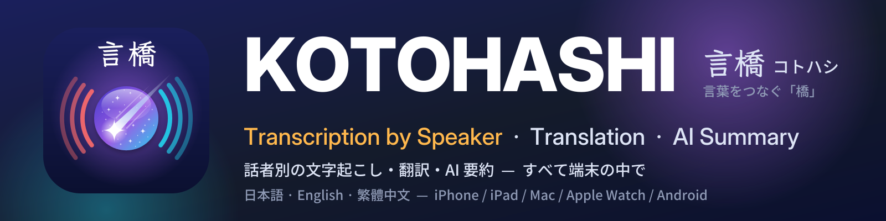
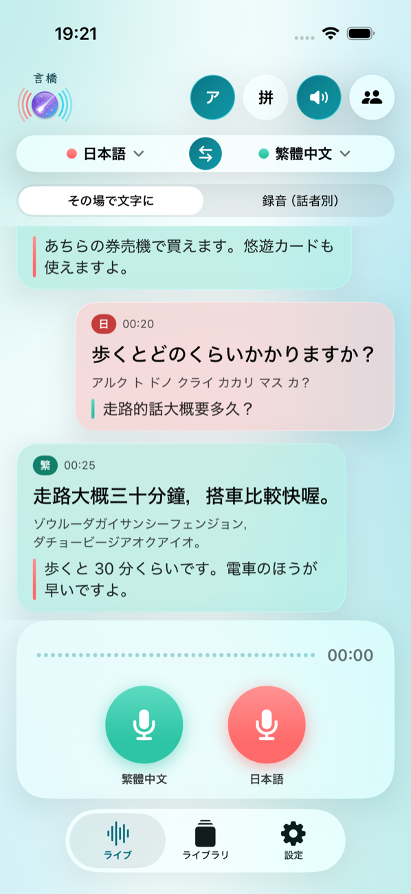
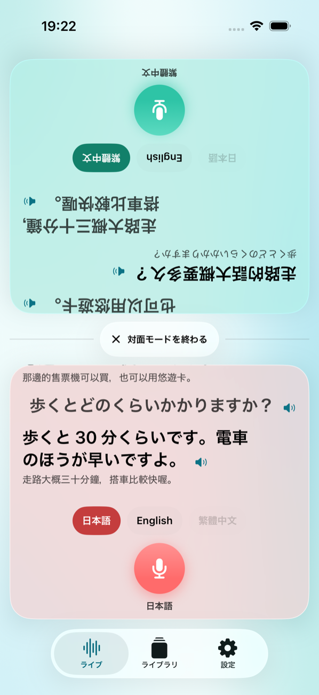
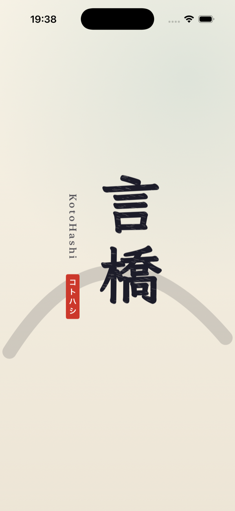
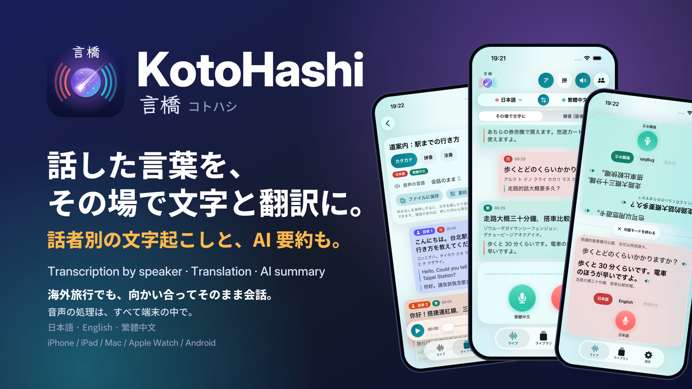

# 言橋 / KotoHashi

**日本語** ｜ 話した言葉をその場で文字にして、翻訳し、読み上げるアプリです。それだけでなく、誰が話したかを分ける「話者別の文字起こし」と、会話の要点をまとめる「AI 要約」も行えます。海外旅行でも役立ちます。向かい合って話せる対面モードと、旅行の場面などの会話例（無料 16 件、有料プランで 64 件）を備えています。日本語・英語・繁體中文（台湾）に対応し、音声の処理はすべて端末の中で行います。
→ [マニュアル（日本語）](docs/manual-ja.md)

**English** ｜ An app that turns speech into text on the spot, translates it, and reads it aloud. It also transcribes by speaker, showing who said what, and summarizes the conversation with AI. It is handy when traveling abroad too, with a face-to-face mode and example conversations for travel and more (16 free, 64 with the paid plan). It supports Japanese, English, and Traditional Chinese (Taiwan), and all audio processing stays on your device.
→ [Manual (English)](docs/manual-en.md)

**繁體中文** ｜ 把說出的話即時轉成文字、翻譯並朗讀的 App。不僅如此，還能做到「依說話者區分的逐字稿」與「AI 摘要」。出國旅行時也很實用：有面對面模式，並內附旅行等情境的會話範例（免費 16 則，付費方案 64 則）。支援日文、英文、繁體中文（台灣），所有語音處理都在裝置內完成。
→ [使用手冊（繁體中文）](docs/manual-zh-TW.md)

| | |
|---|---|
|  |  |

- プライバシーポリシー / Privacy Policy / 隱私權政策: [docs/privacy.md](docs/privacy.md)

## v1.0 の主な機能 / Main features / 主要功能

- ライブの文字起こし・翻訳・読み上げ、対面モード / Live transcription, translation and speech, face-to-face mode / 即時轉寫、翻譯、朗讀與面對面模式
- 録音（話者別）モードと、学習済みモデルによる話者分け（有料プランで最大 8 人） / Record-only mode and speaker separation with a trained model (up to 8 speakers on the paid plan) / 錄音模式與訓練模型的說話者區分（付費方案最多 8 位）
- 中国語の読み方（拼音・注音）とカタカナ表示 / Chinese readings (pinyin, zhuyin) and katakana / 中文讀音（拼音、注音）與片假名
- AI 要約、会話例（無料 16 件・有料 64 件）、Apple Watch での録音 / AI summaries, example conversations (16 free, 64 paid), recording on Apple Watch / AI 摘要、會話範例（免費 16 則、付費 64 則）、Apple Watch 錄音

## プロモーション素材 / Promotional material / 宣傳素材

- 紹介動画 / Promo video / 介紹影片: [promo/promo.mp4](promo/promo.mp4)
- ヘッダー・サムネイルなど / Headers and thumbnails / 橫幅與縮圖: [promo/](promo/)

---

- Version: v1.0（iPhone / iPad / Mac / Apple Watch。Android 版は基本の機能のみ / Android: basic features only / Android 版僅有基本功能）
- バナーとアイコンの文字は、SIL Open Font License のフォント（Inter、Noto Sans JP、LXGW WenKai TC）で描いています。
  The lettering in the banner and icon uses fonts under the SIL Open Font License (Inter, Noto Sans JP, LXGW WenKai TC).
- このリポジトリにはマニュアルだけを置いています。ソースコードは公開していません。
- This repository holds the manuals only. The source code is not public.
- 這個儲存庫只放使用手冊，原始碼未公開。
