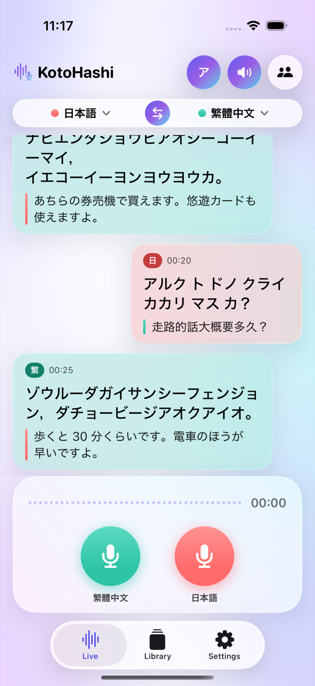
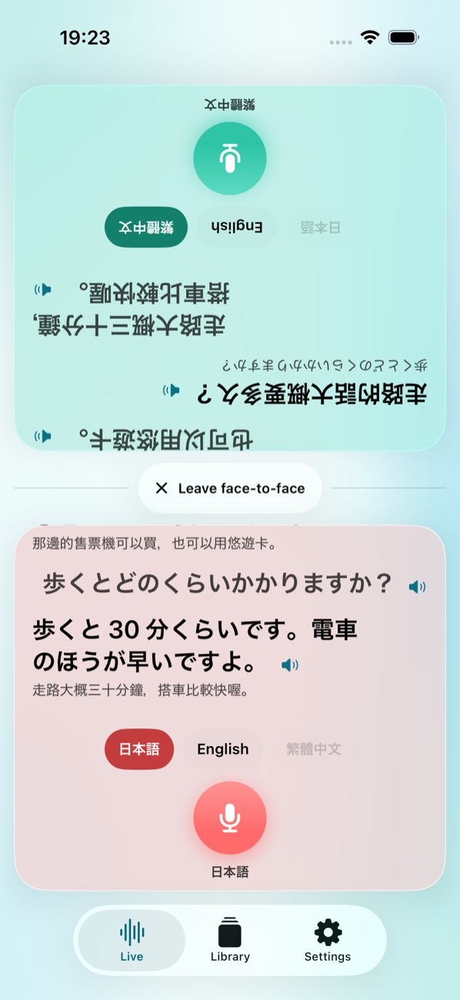
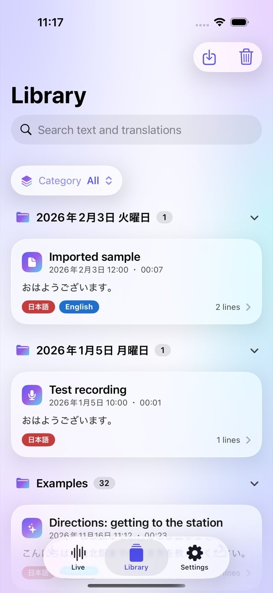
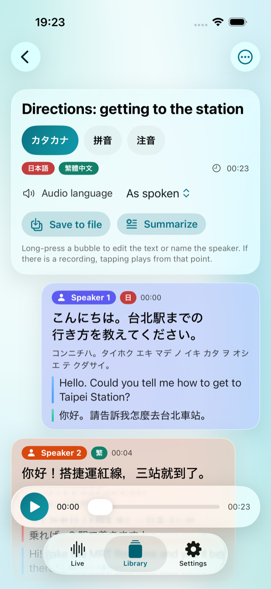
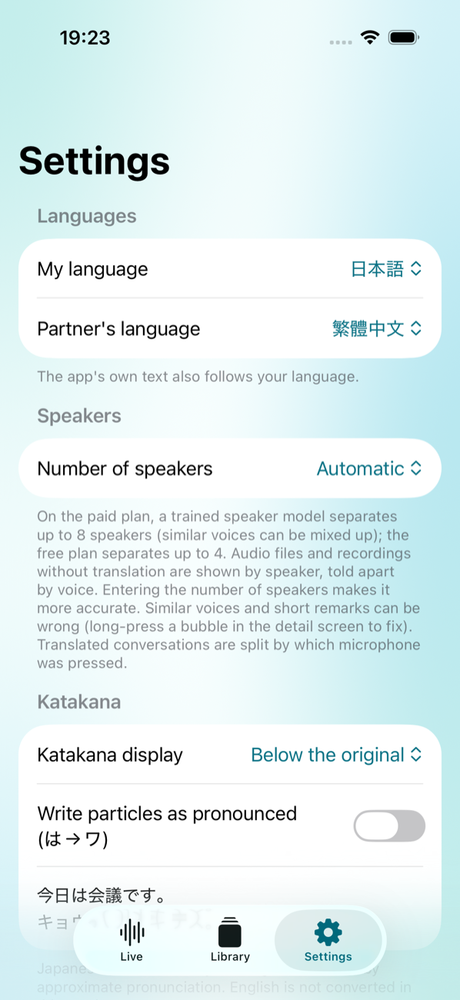

# KotoHashi (言橋) Manual

[日本語](manual-ja.md) ｜ [繁體中文](manual-zh-TW.md) ｜ [Home](../README.md)

KotoHashi (言橋, "a bridge of words") turns speech into text on the spot, translates it, and reads the translation aloud. It also transcribes by speaker, showing who said what, and summarizes the conversation with AI. It is handy when traveling abroad too, with a face-to-face mode and example conversations for travel and more (16 free, 64 with the paid plan).
It supports **Japanese, English, and Traditional Chinese (Taiwan)**. All audio processing happens on your device; neither audio nor text is sent anywhere.

This manual covers v0.1 for iPhone, iPad, and Mac. The Android version supports only the basics of Live, face-to-face mode, the Library, the examples, and Settings (it has no audio-file import, playback of recordings, speaker separation, summaries, or Save to file).

## Contents

1. [Getting started](#1-getting-started)
2. [Live: speak and get text and translation](#2-live-speak-and-get-text-and-translation)
3. [Face-to-face mode](#3-face-to-face-mode)
4. [Library: find and organize sessions](#4-library-find-and-organize-sessions)
5. [Session detail: edit, listen, save](#5-session-detail-edit-listen-save)
6. [Conversation examples](#6-conversation-examples)
7. [Settings](#7-settings)
8. [Privacy](#8-privacy)
9. [Troubleshooting](#9-troubleshooting)
10. [What this version cannot do](#10-what-this-version-cannot-do)
11. [Recording with Apple Watch](#11-recording-with-apple-watch)
12. [Plans](#12-plans)

## 1. Getting started

### Requirements

- iPhone and iPad: iOS 18 or later
- Mac: macOS 15 or later
- On iOS 26 / macOS 26 or later the app uses the newer on-device recognizer. It downloads recognition data for each language once, the first time you use it. That is the only time a network connection is needed.

### First launch

1. The first time you press a microphone button, you are asked to allow the **microphone** and **speech recognition**. Choose Allow for both.
2. The first time you translate between a pair of languages, the system offers to download the translation data.
3. The app's own text follows the "My language" setting: Japanese, English, or Traditional Chinese (it starts in your device's language).

### The three tabs

| Tab | What it does |
|---|---|
| Live | Speak and get text, translation, and speech on the spot |
| Library | Saved sessions, search, import, clearing history |
| Settings | Languages, speakers, katakana, speech, save location, data |

## 2. Live: speak and get text and translation



1. In the language bar at the top, choose **your language** (left) and **your partner's language** (right). If you do not need translation, set the right side to "No translation".
2. Press the **microphone button** at the bottom and speak. Your words appear as text, with the translation underneath.
3. When your partner speaks, press the partner's microphone button (shown only when translation is on). Recording continues; only the language being recognized changes.
4. Press the same microphone button again to stop. The conversation is saved to the Library.

The buttons at the top:

- **ア**: switches the katakana display (off → below the original → katakana only). Japanese shows its reading; Chinese shows an approximate pronunciation.
- **Speaker**: turns reading the translation aloud on or off.
- **Face-to-face mode**: switches to the screen for talking across a table.

Good to know:

- A short pause ends the current utterance.
- While a translation is being read aloud, the microphone is not passed to recognition, so the app does not pick up its own voice (the audio is still recorded). Speak after the reading finishes.

## 3. Face-to-face mode



The screen splits in two, and the top half is turned upside down so that the person across from you can read it. Put the device between the two of you.

- Each side has **text in its own language** and a **microphone button**. Whoever speaks presses the button on their side.
- The **language buttons** on each side (日本語, English, 繁體中文) change that side's language, even while recording. The language used by the other side cannot be chosen. After a change, the conversation so far is translated into the new language too.
- **Tap a sentence** to hear it again in that side's language.
- Words still being spoken appear on the other side as a faint tentative translation (iOS 26 or later).
- The × at the top left leaves face-to-face mode.

## 4. Library: find and organize sessions



- Sessions go into **date folders** automatically. Tap a folder heading to open or close it.
- The **category** menu at the top switches between All, Recordings, Audio files, and Examples.
- The **search field** looks through the original text, translations, and speaker names.
- Tap a card to open the session. Long-press a card to delete it.

### Importing a file

The **import** button (down arrow) at the top right takes two kinds of file:

- **Audio files**: choose the spoken language and the whole file is transcribed from start to end. If any part could not be transcribed, you are told where.
- **Saved transcripts**: a `.txt` or `.json` made with "Save to file" or Export is read back in as a session, including speaker names and translations (no audio is attached).

### Changing dates

- **Long-press** a folder heading → "Change the folder's date" moves every session in it to another day.
- To change a single session, tap the date in its detail screen.

### Clearing history

The **trash** button at the top right clears a range at once.

| Range | What is removed |
|---|---|
| Last hour / Today / Yesterday / Last 7 days | Sessions created in that range |
| Choose dates and times | Sessions between "From" and "To" (a time span, or several days) |
| Everything | All sessions (and the examples, if you turn on "Also remove the examples") |

The number of sessions is shown and you confirm before anything is removed. Removed sessions cannot be restored.

## 5. Session detail: edit, listen, save



- **Play**: the play button at the bottom plays the recording. Tap a bubble to play from that utterance.
- **Edit text**: long-press a bubble → "Edit text".
- **Speakers**:
  - "…" at the top right → "Separate speakers" re-divides the speakers from the voices in the recording (automatic, a set number, or none).
  - **Tap the speaker badge** on a bubble to give that speaker a name.
  - Long-press a bubble to change its speaker.
- **Re-analyze transcription**: transcribes the recording again from start to end (the current text is replaced).
- **Trim the recording**: "…" → "Trim the recording" lets you choose the part to keep (start and end). The transcript for the removed parts is removed too, and this cannot be undone.
- **Translate all**: from "…", translates the whole conversation into the language you choose.
- **Date**: tap the date in the heading to change the date and time.

### Summarize

"**Summarize**" writes the key points of the conversation as a bulleted list under the heading. The summary is written in "My language".

- On iOS 26 / macOS 26 or later, on devices where the on-device AI (Apple Intelligence) is available, the AI writes the summary.
- On other devices or languages, the app picks out the sentences that look most important.
- The note under the summary says which method was used. Both run entirely on the device.
- "…" at the top right of the summary lets you copy it, make it again, or remove it.
- A summary is made from the transcript. If you press Summarize on a recording that has no text yet (for example one from Apple Watch), it is transcribed first and then summarized.
- An AI summary can be wrong. Check important points against the conversation.

### Save to file

"**Save to file**" writes the transcript, with speakers, to a text file.

```
[00:00] Speaker 1: Good morning.
[00:03] Tanaka: Thank you for joining today.
```

- The file goes to `date folder / title.txt` (for example `2026-01-05/Morning meeting.txt`).
- On iPhone it is in the Files app › On My iPhone › コトハシ.
- You can change the folder under "Where 'Save to file' writes" in Settings.
- Saving again replaces the earlier file.

### Export

"…" → "Export" writes txt, md, srt, vtt, or json to any location, with or without katakana and translations.

## 6. Conversation examples

The Library comes with **conversation examples** (16 in the free plan, 64 with the paid plan) for travel and everyday situations (directions, restaurants, hotels, airports, hospitals, night markets, pineapple cakes, the Airport MRT, and more).
Add them with "Show conversation examples" in an empty Library or "Add conversation examples" in Settings.

- Each example has audio.
- "**Audio language**" in the detail screen plays the whole conversation in the language you choose. "As spoken" returns to each speaker's own language.

## 7. Settings



| Item | Meaning |
|---|---|
| My language | The language you speak. **The app's own text follows it** |
| Partner's language | The language to translate into. "No translation" is also available |
| Number of speakers | How many speakers to divide audio files and untranslated recordings into (automatic, none, or 2–10; 5 or more need the paid plan) |
| Katakana display | Off / below the original / katakana only |
| Write particles as pronounced | Writes は as ワ, and so on |
| Speech | Whether to read translations aloud, and how fast |
| Where "Save to file" writes | Choose the folder. Files already saved move with it |
| Data | Add conversation examples / Clear history (choose a range) / Delete all sessions |

Translations are read with the best voice installed on the device. For a more natural voice, download an Enhanced or Premium voice in the iPhone's Settings › Accessibility › Read & Speak › Voices.

## 8. Privacy

- Speech recognition, translation, and speech synthesis all run on the device. No audio or text is sent to any server.
- Recordings, text, and translations are stored only on this device.
- The only network use is the system downloading recognition data, translation data, or voices.

## 9. Troubleshooting

| Problem | Check |
|---|---|
| Pressing the microphone produces no text | In the iPhone's Settings › コトハシ, the microphone and speech recognition are allowed |
| "Speech recognition failed" appears | On iOS 18–25, Siri & Dictation (keyboard dictation) is turned on in Settings |
| Recognition data cannot be downloaded | Press the microphone again where you have a connection (needed only once) |
| No translation appears | The languages are downloaded in Settings › Apps › Translate |
| Speakers are divided wrongly | Set the number of speakers in the detail screen and divide again, or fix bubbles one by one with a long press |
| Words are not recognized | The selected language matches the language being spoken |

## 10. What this version cannot do

- Detect the spoken language automatically (you choose it with the microphone button)
- Import video files (audio files only)
- Show katakana for English
- Remove noise or proofread with AI
- Speakers are told apart by a simple voice-based method that can be wrong for similar voices or short remarks

## 11. Recording with Apple Watch

The Apple Watch app only records. Transcription happens on the iPhone that receives the recording.

1. Open コトハシ on your Apple Watch and **recording starts without pressing anything** (the first time, you are asked to allow the microphone).
2. Press the red button to stop. The recording is sent to your iPhone; if the iPhone is not nearby, it arrives when they reconnect.
3. A session titled "Apple Watch" with the date and time appears in the **Library** of KotoHashi on the iPhone.
4. Open it, press "**Re-analyze transcription**", and choose the spoken language to turn it into text. If you press Summarize instead, it is transcribed and then summarized.

- Turn off "Record on open" to record only when you press the button.
- On an Apple Watch with an Action button, assign "録音を始める" (Start recording) under Watch app › Action Button › Shortcut on the iPhone; one press then opens KotoHashi and starts recording.
- Recording continues when you lower your wrist.

## 12. Plans

| | Free | Paid (¥400 a month) |
|---|---|---|
| Transcriptions | Up to 5 a day | Unlimited |
| Save to file and export | Not available | Available |
| Speakers that can be separated | Up to 4 | Up to 10 |
| Conversation examples | 16 | 64 |

- Starting a recording, importing an audio file, and re-analyzing a transcription each count as one. You get five more the next day.
- Summaries, importing saved transcripts, and recording on Apple Watch are not counted.
- The Android version has the same plans (5 recordings a day; export is paid; the purchase is made through Google Play).
- The paid plan is a monthly subscription that renews automatically until you cancel. Cancel in the iPhone's Settings › your name › Subscriptions.
- Subscribe or restore a purchase under "Plan" in Settings.

---

KotoHashi v0.1. The source code is not public.
