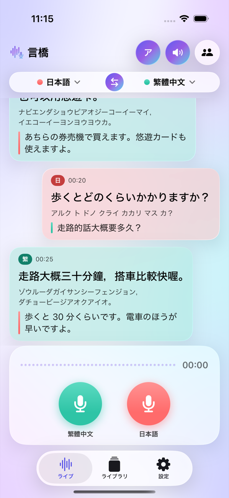
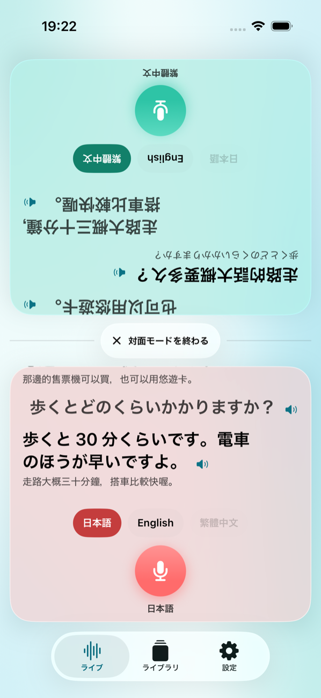
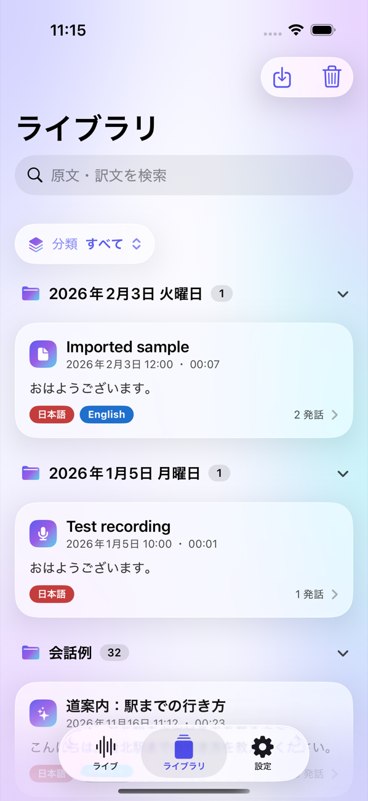
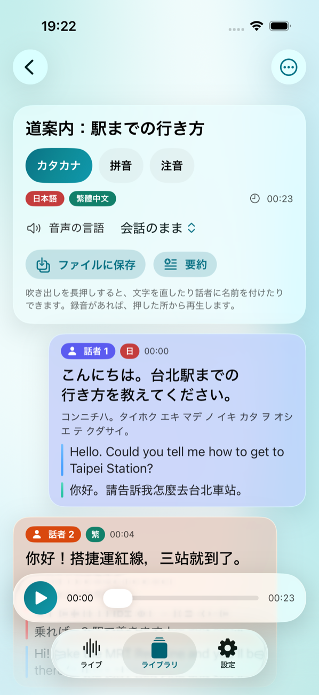
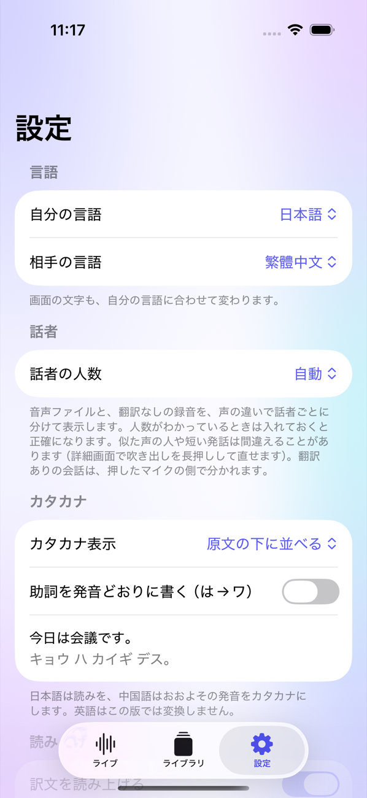

# 言橋（コトハシ）マニュアル

[English](manual-en.md) ｜ [繁體中文](manual-zh-TW.md) ｜ [トップへ](../README.md)

言橋（KotoHashi）は、話した言葉をその場で文字にして、翻訳し、読み上げるアプリです。それだけでなく、誰が話したかを分ける「話者別の文字起こし」と、会話の要点をまとめる「AI 要約」も行えます。海外旅行でも役立ちます。向かい合って話せる対面モードと、旅行の場面などの会話例（無料 16 件、有料プランで 64 件）を備えています。
対応する言語は **日本語・英語・繁體中文（台湾）** です。音声の処理は端末の中だけで行い、音声や文字を外へ送りません。

この文書は v1.0（iPhone・iPad・Mac 版）の使い方です。Android 版は、ライブ・対面モード・ライブラリ・会話例・設定の基本の部分だけに対応しています（音声ファイルの読み込み、録音の再生、声による話者の区別、要約、ファイルに保存などはありません）。

## 目次

1. [はじめに](#1-はじめに)
2. [ライブ：話してその場で文字と翻訳にする](#2-ライブ話してその場で文字と翻訳にする)
3. [対面モード：向かい合って話す](#3-対面モード向かい合って話す)
4. [ライブラリ：記録を探す・整理する](#4-ライブラリ記録を探す整理する)
5. [記録の詳細：直す・聞く・保存する](#5-記録の詳細直す聞く保存する)
6. [会話例](#6-会話例)
7. [設定](#7-設定)
8. [プライバシー](#8-プライバシー)
9. [うまくいかないとき](#9-うまくいかないとき)
10. [今の版でできないこと](#10-今の版でできないこと)
11. [Apple Watch で録音する](#11-apple-watch-で録音する)
12. [料金のプラン](#12-料金のプラン)

## 1. はじめに

### 動く環境

- iPhone・iPad：iOS 18 以上
- Mac：macOS 15 以上
- iOS 26 / macOS 26 以上では、新しい端末内認識を使います。このとき、言語ごとの認識データを最初の 1 回だけダウンロードします（通信が要るのはこのときだけです）。

### 最初の起動

1. マイクボタンを最初に押したとき、**マイク**と**音声認識**の許可を求められます。どちらも「許可」を選んでください。
2. 翻訳を初めて使う言語の組み合わせでは、OS が翻訳データのダウンロードを案内します。
3. 画面の文字は、設定の「自分の言語」に合わせて日本語・英語・繁體中文に変わります（最初は端末の言語です）。

### 画面の構成

下のタブで 3 つの画面を切り替えます。

| タブ | できること |
|---|---|
| ライブ | 話して、その場で文字・翻訳・読み上げ |
| ライブラリ | 保存した記録の一覧、検索、読み込み、まとめて削除 |
| 設定 | 言語、話者、カタカナ、読み上げ、保存先、データ |

## 2. ライブ：話してその場で文字と翻訳にする



1. 上の言語バーで、**自分の言語**（左）と**相手の言語**（右）を選びます。翻訳が要らないときは、右を「翻訳なし」にします。
2. 下の**マイクボタン**を押して話します。話した言葉が文字になり、相手の言語の訳がその下に出ます。
3. 相手が話すときは、相手側のマイクボタンを押します（翻訳ありのときだけ出ます）。録音は続いたまま、聞き取る言語が切り替わります。
4. もう一度同じマイクボタンを押すと止まり、会話は記録としてライブラリに保存されます。

上のボタンでできること：

- **ア**：カタカナ表示を切り替えます（オフ → 原文の下 → カタカナだけ）。日本語は読み、中国語はおおよその発音をカタカナで出します。
- **スピーカー**：訳文の読み上げをオン・オフします。
- **対面モード**：向かい合って話すための画面に切り替えます。

知っておくとよい点：

- 少し間を置くと、そこまでが 1 つの発話として確定します。
- 訳文を読み上げているあいだは、読み上げの声を拾わないよう、マイクの音を認識に回しません（録音には残ります）。読み上げが終わってから話してください。

## 3. 対面モード：向かい合って話す



画面が上下に分かれ、上半分は相手から読める向き（逆さ）になります。端末を 2 人のあいだに置いて使います。

- それぞれの側に、**自分の言語の文字**と**マイクボタン**があります。話す人が自分の側のマイクボタンを押します。
- それぞれの側の**言語ボタン**（日本語・English・繁體中文）で、録音の途中でも言語を変えられます。もう片側が使っている言語は選べません。変えると、それまでの会話も新しい言語に訳します。
- **文を押す**と、その側の言語でもう一度読み上げます。
- 話している途中の言葉も、相手側に仮の訳として薄く出ます（iOS 26 以上）。
- 左上の × で対面モードを終わります。

## 4. ライブラリ：記録を探す・整理する



- 記録は**日付のフォルダー**に自動で入ります。フォルダーの見出しを押すと開け閉めできます。
- 上の**分類**で、すべて／録音／音声ファイル／会話例を切り替えます。
- **検索欄**に言葉を入れると、原文・訳文・話者の名前から探します。
- カードを押すと、記録の詳細が開きます。カードの長押しで削除できます。

### ファイルを読み込む

右上の**読み込む**ボタン（下向き矢印）から、次の 2 種類を読み込めます。

- **音声ファイル**：話されている言語を選ぶと、頭から終わりまで文字にします。文字にできなかった所があれば、時刻を知らせます。
- **保存した文字起こし**：「ファイルに保存」や書き出しで作った `.txt` / `.json` を、記録として読み戻します。話者の名前や訳文も戻ります（録音は付きません）。

### 日付を直す

- フォルダーの見出しを**長押し** →「フォルダーの日付を変える」で、中の記録をまとめて別の日へ移します。
- 記録 1 件だけ直すときは、詳細画面の日付を押します。

### 履歴をまとめて消す

右上の**ごみ箱**のボタンで、範囲を選んでまとめて消せます。

| 範囲 | 消えるもの |
|---|---|
| この 1 時間／今日／昨日／過去 7 日 | その範囲に作られた記録 |
| 日時を指定 | 「ここから」「ここまで」の間の記録（時間帯や、何日かぶん） |
| すべて | すべての記録（「会話例も消す」を選ぶと会話例も） |

消す件数を確かめてから消します。消した記録は元に戻せません。

## 5. 記録の詳細：直す・聞く・保存する



- **再生**：下の再生ボタンで録音を聞けます。吹き出しを押すと、その発話から再生します。
- **文字を直す**：吹き出しを長押し →「文字を直す」。
- **話者**：
  - 右上の「…」→「話者を分ける」で、録音の声から話者を分け直します（自動／人数を指定／分けない）。
  - 吹き出しの**話者のバッジを押す**と、その話者に名前を付けられます。
  - 吹き出しの長押しで、その発話の話者を変えられます。
- **文字起こしを再解析**：録音の頭から終わりまでを文字にし直します（今の文字は置き換わります）。
- **録音をトリミング**：「…」→「録音をトリミング」で、残す範囲（始まりと終わり）を選んで切ります。切った部分の文字起こしも消え、元に戻せません。
- **まとめて翻訳**：「…」から、会話全体を選んだ言語に訳します。
- **日付**：見出しの日付を押すと、日付と時刻を直せます。

### 要約

「**要約**」を押すと、会話の要点を箇条書きにして、見出しの下に出します。要約は「自分の言語」で書きます。

- iOS 26 / macOS 26 以上で、端末内の AI（Apple Intelligence）が使える端末では、AI が要約を書きます。
- 使えない端末や言語では、会話の中から重要そうな文を抜き出します。
- どちらの方法で作ったかは、要約の下に出ます。どちらも端末の中だけで行います。
- 要約の右上の「…」から、コピー・作り直す・消すができます。
- 要約は文字起こしの結果から作ります。まだ文字の無い録音（Apple Watch で録ったものなど）で「要約」を押すと、先に文字起こしをしてから要約します。
- AI の要約は内容が違うことがあります。大事な所は元の会話で確かめてください。

### ファイルに保存

「**ファイルに保存**」を押すと、話者つきの文字起こしをテキストファイルで保存します。

```
[00:00] 話者 1: おはようございます。
[00:03] 田中: 今日もよろしくお願いします。
```

- 保存先は `日付のフォルダー / 題名.txt` です（例：`2026-01-05/朝の打ち合わせ.txt`）。
- iPhone では「ファイル」アプリ ›「この iPhone 内」›「コトハシ」に入ります。
- 保存先のフォルダーは、設定の「『ファイルに保存』の保存先」で変えられます。
- もう一度保存すると、前のファイルを置き換えます。

### 書き出し

「…」→「書き出し」で、txt / md / srt / vtt / json の形式で、好きな場所へ書き出せます。カタカナや訳文を入れるかどうかも選べます。

## 6. 会話例

ライブラリには、旅行や日常の場面の**会話例**が入っています。無料では 16 件、有料プランでは 64 件です（道案内、レストラン、ホテル、空港、病院、夜市、パイナップルケーキ、空港 MRT など）。
空のライブラリでは「会話例を見る」、設定では「会話例を追加」で入れられます。

- 会話例には音声が付いています。
- 詳細画面の「**音声の言語**」で言語を選ぶと、会話の全部をその言語で聞けます。「会話のまま」を選ぶと、それぞれの話者の言語に戻ります。

## 7. 設定



| 項目 | 内容 |
|---|---|
| 自分の言語 | 自分が話す言語。**画面の文字もこの言語になります** |
| 相手の言語 | 翻訳先の言語。「翻訳なし」も選べます |
| 話者の人数 | 音声ファイルと、翻訳なしの録音を話者ごとに分けるときの人数（自動／分けない／2〜8 人。5 人以上は有料プラン） |
| カタカナ表示 | オフ／原文の下に並べる／カタカナだけ |
| 助詞を発音どおりに書く | 「は」を「ワ」のように書きます |
| 読み上げ | 訳文を読み上げるかどうかと、速さ |
| 「ファイルに保存」の保存先 | 保存するフォルダーを選べます。変えると、保存済みのファイルも移します |
| データ | 会話例を追加／履歴を消す（範囲を選ぶ）／すべての記録を削除 |

読み上げの声は、端末に入っている中でいちばん品質の高い声を使います。もっと自然な声にしたいときは、iPhone の「設定」›「アクセシビリティ」›「読み上げコンテンツ」›「声」から、拡張・プレミアムの声をダウンロードしてください。

## 8. プライバシー

- 音声認識・翻訳・読み上げは、すべて端末の中で行います。音声や文字を外のサーバーへ送りません。
- 録音・文字・訳文は、この端末の中だけに保存します。
- 通信をするのは、OS が認識データ・翻訳データ・読み上げの声をダウンロードするときだけです。

## 9. うまくいかないとき

| 困りごと | 確かめること |
|---|---|
| マイクを押しても文字にならない | iPhone の「設定」›「コトハシ」で、マイクと音声認識が許可されているか |
| 「音声認識ができませんでした」と出る | iOS 18〜25 では、「設定」で「Siri と音声入力（キーボードの音声入力）」がオンになっているか |
| 認識データをダウンロードできない | 通信できる場所で、もう一度マイクを押す（最初の 1 回だけ必要です） |
| 訳が出ない | 「設定」›「アプリ」›「翻訳」で、その言語がダウンロードされているか |
| 話者の分け方が違う | 詳細画面で人数を指定して分け直すか、吹き出しの長押しで 1 つずつ直す |
| 言葉が聞き取られない | 選んだ言語が、話している言語と合っているか |

## 10. 今の版でできないこと

- 話している言語の自動判定（話す側のマイクボタンで選びます）
- 動画ファイルの読み込み（音声ファイルだけ）
- 英語のカタカナ表示
- 雑音の除去、AI による校正
- 話者の区別は声の違いによる簡易な方式で、似た声や短い発話では間違えることがあります

## 11. Apple Watch で録音する

Apple Watch 版は、録音だけを行います。文字起こしは、録音が届いた iPhone で行います。

1. Apple Watch で「コトハシ」を開くと、**ボタンを押さなくても録音が始まります**（最初の 1 回だけ、マイクの許可を求められます）。
2. 赤いボタンを押すと止まり、録音を iPhone へ送ります。iPhone が近くに無いときは、つながったときに届きます。
3. iPhone の言橋の**ライブラリ**に、「Apple Watch 日時」という題名の記録が入ります。
4. その記録を開いて「**文字起こしを再解析**」を押し、話されている言語を選ぶと、文字になります。「要約」を押した場合は、文字起こしのあとに続けて要約します。

- 「開いたらすぐ録音」をオフにすると、ボタンを押したときだけ録音します。
- アクションボタンのある Apple Watch では、iPhone の「Watch」アプリ ›「アクションボタン」›「ショートカット」に「録音を始める」を割り当てると、ボタンを押すだけで言橋が開いて録音が始まります。
- 手首を下ろしても録音は続きます。

## 12. 料金のプラン

| | 無料 | 有料（月額 400 円） |
|---|---|---|
| 文字起こしの回数 | 1 日 5 回まで | 無制限 |
| ファイルに保存・書き出し | 使えません | 使えます |
| 話者を分ける人数 | 4 人まで | 最大 8 人に分けられます（声が似ていると取り違えることがあります） |
| 会話例 | 16 件 | 64 件 |

- 1 回と数えるのは、録音の開始・音声ファイルの読み込み・文字起こしの再解析です。日付が変わると、また 5 回使えます。
- 要約、保存した文字起こしの読み込み、Apple Watch での録音は、回数に数えません。
- Android 版も同じプランです（録音は 1 日 5 回まで、書き出しは有料。購入は Google Play から）。
- 有料プランは月額のサブスクリプションです。解約するまで毎月自動で更新されます。解約は iPhone の「設定」› 自分の名前 ›「サブスクリプション」からできます。
- 申し込みと「購入を復元」は、設定の「プラン」から行います。

---

言橋 v1.0 ／ ソースコードは公開していません。
