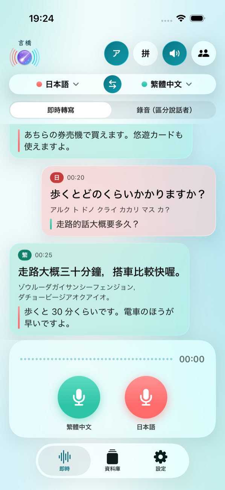
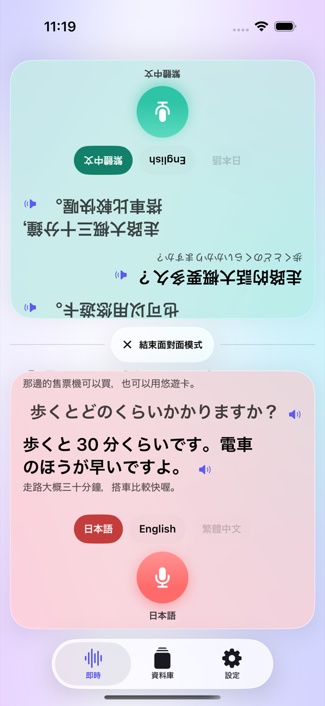
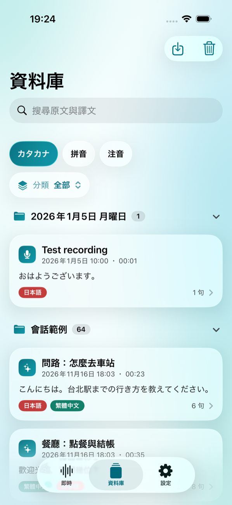
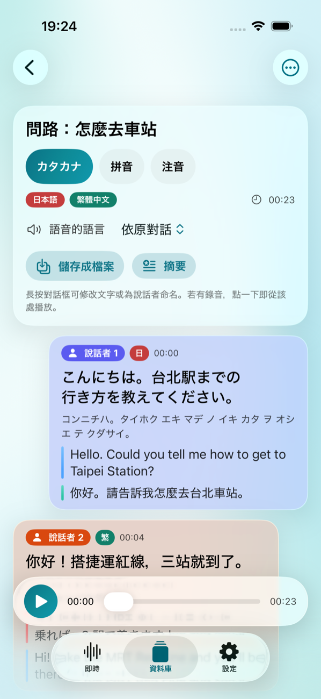
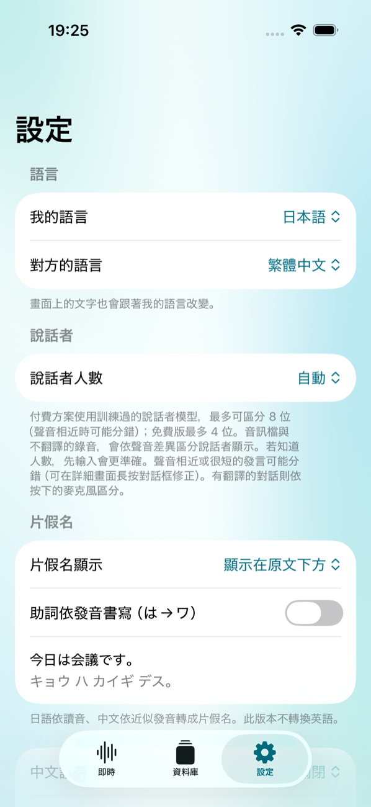

# 言橋（KotoHashi）使用手冊

[日本語](manual-ja.md) ｜ [English](manual-en.md) ｜ [首頁](../README.md)

言橋（KotoHashi，意思是「語言的橋」）能把說出的話即時轉成文字、翻譯，並朗讀譯文。不僅如此，還能做到「依說話者區分的逐字稿」與「AI 摘要」。出國旅行時也很實用：有面對面模式，並內附旅行等情境的會話範例（免費 16 則，付費方案 64 則）。
支援 **日文、英文、繁體中文（台灣）**。所有語音處理都在裝置內完成，語音和文字都不會傳到外部。

本手冊說明 v1.0（iPhone、iPad、Mac 版）的用法。Android 版只支援即時、面對面模式、資料庫、會話範例和設定的基本功能（沒有匯入音訊檔、播放錄音、區分說話者、摘要、儲存到檔案等功能）。

## 目錄

1. [開始使用](#1-開始使用)
2. [即時：說話就變成文字和翻譯](#2-即時說話就變成文字和翻譯)
3. [面對面模式](#3-面對面模式)
4. [資料庫：尋找與整理紀錄](#4-資料庫尋找與整理紀錄)
5. [紀錄詳細內容：修改、聆聽、儲存](#5-紀錄詳細內容修改聆聽儲存)
6. [會話範例](#6-會話範例)
7. [設定](#7-設定)
8. [隱私](#8-隱私)
9. [遇到問題時](#9-遇到問題時)
10. [這個版本做不到的事](#10-這個版本做不到的事)
11. [用 Apple Watch 錄音](#11-用-apple-watch-錄音)
12. [付費方案](#12-付費方案)

## 1. 開始使用

### 系統需求

- iPhone、iPad：iOS 18 以上
- Mac：macOS 15 以上
- 在 iOS 26 / macOS 26 以上會使用新的裝置內辨識，第一次使用某個語言時會下載該語言的辨識資料（只有這時需要網路）。

### 第一次開啟

1. 第一次按麥克風按鈕時，系統會要求允許使用**麥克風**和**語音辨識**，請都選「允許」。
2. 第一次翻譯某一組語言時，系統會提示下載翻譯資料。
3. 畫面上的文字會跟著設定中的「我的語言」變成日文、英文或繁體中文（一開始是裝置的語言）。

### 畫面組成

用下方的標籤切換三個畫面。

| 標籤 | 功能 |
|---|---|
| 即時 | 說話後即時顯示文字、翻譯並朗讀 |
| 資料庫 | 已儲存的紀錄、搜尋、匯入、整批清除 |
| 設定 | 語言、說話者、片假名、朗讀、儲存位置、資料 |

## 2. 即時：說話就變成文字和翻譯



1. 在上方的語言列選擇**我的語言**（左）和**對方的語言**（右）。不需要翻譯時，把右邊設為「不翻譯」。
2. 按下方的**麥克風按鈕**開始說話。說的話會變成文字，下面顯示對方語言的譯文。
3. 對方說話時，按對方那一側的麥克風按鈕（只有開啟翻譯時才會出現）。錄音不會中斷，只是切換辨識的語言。
4. 再按一次同一個麥克風按鈕就會停止，對話會存到資料庫。

上方按鈕的功能：

- **ア**：切換片假名顯示（關閉 → 顯示在原文下方 → 只顯示片假名）。日文顯示讀音，中文顯示近似的發音。
- **喇叭**：開啟或關閉譯文朗讀。
- **面對面模式**：切換成面對面交談用的畫面。

小提醒：

- 稍微停頓一下，前面說的話就會確定成一句。
- 朗讀譯文時，為了不把朗讀的聲音當成說話，麥克風的聲音不會送去辨識（錄音仍會保留）。請等朗讀結束後再說話。

## 3. 面對面模式



畫面分成上下兩半，上半部會倒過來，讓對面的人可以閱讀。請把裝置放在兩人之間。

- 兩側各有**自己語言的文字**和**麥克風按鈕**。說話的人按自己那一側的按鈕。
- 兩側的**語言按鈕**（日本語、English、繁體中文）可以在錄音中途更改語言，但不能選另一側正在使用的語言。更改後，之前的對話也會翻譯成新的語言。
- **點一下句子**，會用那一側的語言再朗讀一次。
- 還在說的話，也會以淡色的暫時譯文顯示在對方那一側（iOS 26 以上）。
- 左上角的 × 可結束面對面模式。

## 4. 資料庫：尋找與整理紀錄



- 紀錄會自動放進**日期資料夾**。點資料夾標題可以展開或收合。
- 上方的**分類**可切換全部／錄音／音訊檔／會話範例。
- 在**搜尋欄**輸入文字，會從原文、譯文和說話者名稱中尋找。
- 點卡片可開啟紀錄的詳細內容。長按卡片可以刪除。

### 匯入檔案

右上角的**匯入**按鈕（向下箭頭）可以匯入兩種檔案：

- **音訊檔**：選擇檔案中說的語言後，會從頭到尾轉成文字。若有無法轉成文字的部分，會告訴你時間。
- **已儲存的逐字稿**：用「儲存到檔案」或匯出產生的 `.txt` / `.json`，可以讀回成紀錄，說話者名稱和譯文也會還原（不含錄音）。

### 更改日期

- **長按**資料夾標題 →「更改資料夾日期」，可以把裡面的紀錄整批移到另一天。
- 只想改一筆紀錄時，點詳細畫面中的日期。

### 整批清除紀錄

右上角的**垃圾桶**按鈕可以選擇範圍一次清除。

| 範圍 | 會刪除的內容 |
|---|---|
| 過去 1 小時／今天／昨天／過去 7 天 | 在該範圍內建立的紀錄 |
| 指定日期與時間 | 「從」到「到」之間的紀錄（某個時段，或好幾天） |
| 全部 | 所有紀錄（勾選「一併刪除會話範例」時也包含範例） |

清除前會顯示筆數並再次確認。清除後無法復原。

## 5. 紀錄詳細內容：修改、聆聽、儲存



- **播放**：用下方的播放按鈕聽錄音。點對話框會從那一句開始播放。
- **修改文字**：長按對話框 →「修改文字」。
- **說話者**：
  - 右上角「…」→「區分說話者」，會依錄音中的聲音重新區分說話者（自動／指定人數／不區分）。
  - **點對話框上的說話者標籤**，可以為該說話者命名。
  - 長按對話框，可以更改那一句的說話者。
- **重新分析轉寫**：把錄音從頭到尾重新轉成文字（目前的文字會被取代）。
- **裁剪錄音**：「…」→「裁剪錄音」，選擇要保留的範圍（開始與結束）後裁剪。被裁掉部分的逐字稿也會刪除，且無法復原。
- **全部翻譯**：從「…」把整段對話翻譯成所選的語言。
- **日期**：點標題中的日期，可以修改日期和時間。

### 摘要

按「**摘要**」，會把對話的重點整理成條列，顯示在標題下方。摘要會用「我的語言」撰寫。

- 在 iOS 26 / macOS 26 以上，且可使用裝置內 AI（Apple Intelligence）的裝置上，由 AI 撰寫摘要。
- 在無法使用的裝置或語言，會從對話中挑出較重要的句子。
- 摘要下方會說明使用的是哪一種方式。兩種方式都只在裝置內進行。
- 摘要右上角的「…」可以拷貝、重新產生或刪除。
- 摘要是根據逐字稿產生的。對還沒有文字的錄音（例如用 Apple Watch 錄的）按「摘要」時，會先轉成文字再產生摘要。
- AI 摘要的內容可能有誤，重要的部分請對照原對話確認。

### 儲存到檔案

按「**儲存到檔案**」，會把含說話者的逐字稿存成文字檔。

```
[00:00] 說話者 1: 早安。
[00:03] 田中: 今天也請多多指教。
```

- 儲存位置是 `日期資料夾 / 標題.txt`（例如 `2026-01-05/早上的會議.txt`）。
- 在 iPhone 上位於「檔案」App ›「我的 iPhone」›「コトハシ」。
- 儲存的資料夾可以在設定的「『儲存到檔案』的位置」中更改。
- 再儲存一次會取代之前的檔案。

### 匯出

「…」→「匯出」可以用 txt / md / srt / vtt / json 格式匯出到任何位置，也可以選擇是否包含片假名和譯文。

## 6. 會話範例

資料庫內附旅行與日常情境的**會話範例**（免費 16 則，付費方案 64 則）（問路、餐廳、飯店、機場、醫院、夜市、鳳梨酥、機場捷運等）。
資料庫是空的時候按「查看會話範例」，或在設定中按「加入會話範例」即可加入。

- 會話範例附有語音。
- 在詳細畫面的「**語音的語言**」選擇語言後，整段對話都會用該語言播放。選「依原對話」會恢復成各說話者原本的語言。

## 7. 設定



| 項目 | 說明 |
|---|---|
| 我的語言 | 自己說的語言。**畫面上的文字也會變成這個語言** |
| 對方的語言 | 翻譯的目標語言，也可以選「不翻譯」 |
| 說話者人數 | 區分音訊檔和未翻譯錄音的說話者時使用的人數（自動／不區分／2〜8 人，5 人以上需付費方案） |
| 片假名顯示 | 關閉／顯示在原文下方／只顯示片假名 |
| 助詞依發音書寫 | 例如把「は」寫成「ワ」 |
| 朗讀 | 是否朗讀譯文，以及朗讀速度 |
| 「儲存到檔案」的位置 | 選擇儲存的資料夾。更改後，已儲存的檔案也會一起移動 |
| 資料 | 加入會話範例／清除紀錄（選擇範圍）／刪除所有紀錄 |

朗讀會使用裝置中品質最高的聲音。想要更自然的聲音時，請到 iPhone 的「設定」›「輔助使用」›「朗讀內容」›「聲音」下載「增強」或「高級」的聲音。

## 8. 隱私

- 語音辨識、翻譯和朗讀全部在裝置內進行，語音和文字都不會傳到外部伺服器。
- 錄音、文字和譯文只儲存在本裝置內。
- 只有在系統下載辨識資料、翻譯資料或朗讀聲音時才會使用網路。

## 9. 遇到問題時

| 問題 | 請確認 |
|---|---|
| 按了麥克風卻沒有文字 | iPhone 的「設定」›「コトハシ」中，是否已允許麥克風和語音辨識 |
| 出現「無法進行語音辨識」 | 在 iOS 18〜25，「設定」中的「Siri 與聽寫（鍵盤聽寫）」是否已開啟 |
| 無法下載辨識資料 | 到有網路的地方再按一次麥克風（只需要下載一次） |
| 沒有出現譯文 | 「設定」›「App」›「翻譯」中是否已下載該語言 |
| 說話者區分錯誤 | 在詳細畫面指定人數後重新區分，或長按對話框逐一修改 |
| 聽不出說的話 | 所選的語言是否和實際說的語言相同 |

## 10. 這個版本做不到的事

- 自動判斷說話的語言（要用麥克風按鈕選擇）
- 匯入影片檔（只支援音訊檔）
- 英文的片假名顯示
- 去除雜音、AI 校對
- 說話者是用簡易的聲音差異來區分，聲音相近或句子很短時可能會出錯

## 11. 用 Apple Watch 錄音

Apple Watch 版只負責錄音，轉成文字是在收到錄音的 iPhone 上進行。

1. 在 Apple Watch 上開啟「コトハシ」，**不用按任何按鈕就會開始錄音**（第一次會要求允許使用麥克風）。
2. 按紅色按鈕停止，錄音會傳到 iPhone。iPhone 不在附近時，會在重新連線後送達。
3. iPhone 上言橋的**資料庫**會出現標題為「Apple Watch 日期時間」的紀錄。
4. 開啟該紀錄，按「**重新分析轉寫**」並選擇說話的語言，就會轉成文字。若按「摘要」，會先轉成文字再接著產生摘要。

- 關閉「開啟後立即錄音」後，只有按下按鈕時才會錄音。
- 有動作按鈕的 Apple Watch，可在 iPhone 的「Watch」App ›「動作按鈕」›「捷徑」指定「録音を始める」（開始錄音），之後按一下按鈕就會開啟言橋並開始錄音。
- 放下手腕後仍會繼續錄音。

## 12. 付費方案

| | 免費 | 付費（每月 400 日圓） |
|---|---|---|
| 轉寫次數 | 每天最多 5 次 | 無上限 |
| 儲存成檔案與匯出 | 無法使用 | 可以使用 |
| 可區分的說話者人數 | 最多 4 位 | 最多可區分 8 位（聲音相近時可能分錯） |
| 會話範例 | 16 則 | 64 則 |

- 開始錄音、匯入音訊檔、重新分析轉寫各算一次。隔天又可以使用 5 次。
- 摘要、匯入已儲存的逐字稿、用 Apple Watch 錄音都不計入次數。
- Android 版的方案相同（每天最多錄音 5 次，匯出需付費，透過 Google Play 購買）。
- 付費方案是每月訂閱，在取消前會每月自動續訂。可在 iPhone 的「設定」› 您的名稱 ›「訂閱項目」中取消。
- 訂閱與「回復購買」請在設定的「方案」中進行。

---

言橋 v1.0 ／ 原始碼未公開。
